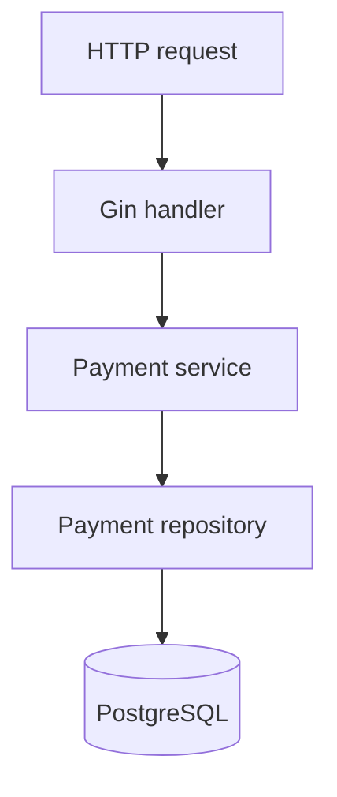

# Distributed Payment Orchestration Platform

A Go HTTP API that creates payment records and stores them in PostgreSQL. Each new payment gets a generated reference and starts with `pending` status.

## What it does

- `GET /health` returns the service health status.
- `POST /payments` validates and stores a payment request.
- PostgreSQL stores payment records. GORM applies the model schema at startup.

## Requirements

- Go 1.27.1 or later
- PostgreSQL

## Quick start

1. Start PostgreSQL. For a local development database, you can use Podman:

   ```bash
   podman run --name payment-db \
     -e POSTGRES_USER=payment_user \
     -e POSTGRES_PASSWORD=payment_pass \
     -e POSTGRES_DB=payment_db \
     -p 5432:5432 \
     -d docker.io/library/postgres:latest
   ```

2. Create a `.env` file in the project root:

   ```dotenv
   DB_HOST=localhost
   DB_PORT=5432
   DB_USER=payment_user
   DB_PASSWORD=payment_pass
   DB_NAME=payment_db
   DB_SSL_MODE=disable
   PORT=8080
   ```

   The application reads `.env` when it starts. Environment variables set in the shell are also used.

3. Run the API:

   ```bash
   go run ./cmd/api
   ```

   The server listens on port `8080` by default. It connects to PostgreSQL and applies the GORM model migration at startup.

4. Check that the API is running:

   ```bash
   curl http://localhost:8080/health
   ```

   Expected response:

   ```json
   {"status":"ok"}
   ```

## Create a payment

Send a positive integer amount, a three-character currency, and a provider name of up to 30 characters:

```bash
curl -X POST http://localhost:8080/payments \
  -H 'Content-Type: application/json' \
  -d '{"amount":1250,"currency":"USD","provider":"stripe"}'
```

The API returns `201 Created` with the stored payment. It generates a reference in the form `PAY_<32 hexadecimal characters>` and sets the initial status to `pending`. Currency is trimmed and converted to uppercase.

Invalid JSON or payment fields return `400 Bad Request`.

## Configuration

| Variable | Default | Purpose |
| --- | --- | --- |
| `PORT` | `8080` | HTTP server port |
| `DB_HOST` | `localhost` | PostgreSQL host |
| `DB_PORT` | `5432` | PostgreSQL port |
| `DB_USER` | — | PostgreSQL user |
| `DB_PASSWORD` | — | PostgreSQL password |
| `DB_NAME` | — | PostgreSQL database name |
| `DB_SSL_MODE` | — | PostgreSQL SSL mode; set this for your environment, such as `disable` for local development |

## Run tests

```bash
go test ./...
```

Build all packages with:

```bash
go build ./...
```

## Project flow



Application code is under `internal/`. The SQL schema migration files are under `migrations/`; startup currently uses GORM `AutoMigrate` for the payment model.
