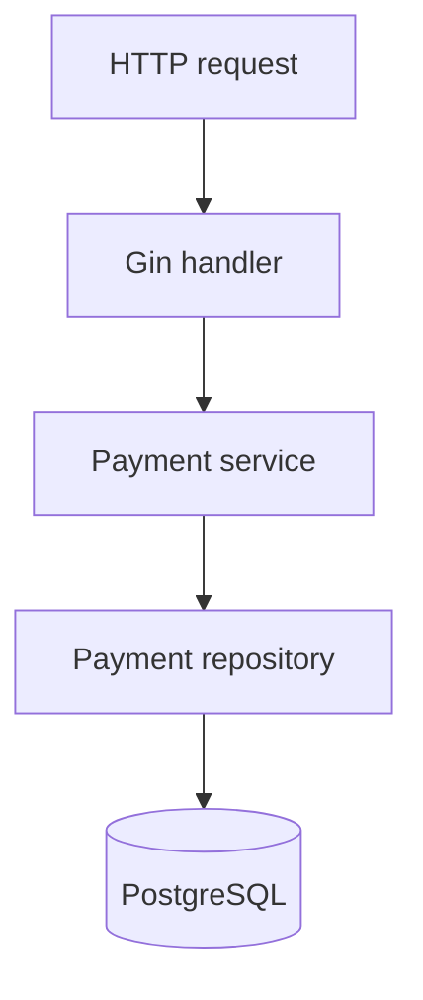

# Distributed Payment Orchestration Platform

A Go HTTP API that creates payment records and stores them in PostgreSQL. Each new payment gets a generated reference and starts with `pending` status.

## What it does

- `GET /health` returns the service health status.
- `POST /payments` validates and stores a payment request.
- PostgreSQL stores payment records. GORM applies the model schema at startup.

## Requirements

- Go 1.27.1 or later
- PostgreSQL

## Quick start

1. Start PostgreSQL. For a local development database, you can use Podman:

   ```bash
   podman run --name payment-db \
     -e POSTGRES_USER=payment_user \
     -e POSTGRES_PASSWORD=payment_pass \
     -e POSTGRES_DB=payment_db \
     -p 5432:5432 \
     -d docker.io/library/postgres:latest
   ```

2. Create a `.env` file in the project root:

   ```dotenv
   DB_HOST=localhost
   DB_PORT=5432
   DB_USER=payment_user
   DB_PASSWORD=payment_pass
   DB_NAME=payment_db
   DB_SSL_MODE=disable
   PORT=8080
   ```

   The application reads `.env` when it starts. Environment variables set in the shell are also used.

3. Run the API:

   ```bash
   go run ./cmd/api
   ```

   The server listens on port `8080` by default. It connects to PostgreSQL and applies the GORM model migration at startup.

4. Check that the API is running:

   ```bash
   curl http://localhost:8080/health
   ```

   Expected response:

   ```json
   {"status":"ok"}
   ```

## Create a payment

Send a positive integer amount, a three-character currency, a provider name of up to 30 characters, and a valid customer email:

```bash
curl -X POST http://localhost:8080/payments \
  -H 'Content-Type: application/json' \
  -d '{"amount":1250,"currency":"USD","provider":"stripe","email":"customer@example.com"}'
```

The API returns `201 Created` with the stored payment. It generates a reference in the form `PAY_<32 hexadecimal characters>` and sets the initial status to `pending`. Currency is trimmed and converted to uppercase.

**Note:** The `email` and `provider_reference` fields are excluded from responses for privacy and security.

Invalid JSON or payment fields return `400 Bad Request`.

## Checkout flow

Payments follow a lifecycle from creation through verification. The flow is:

1. **Create** a pending payment
2. **Initialize** the transaction to get a checkout link
3. Customer **completes payment** using the checkout link
4. **Verify** the payment status

### Initialize a transaction

After creating a payment, call the initialize endpoint to get the checkout URL:

```bash
curl -X POST http://localhost:8080/payments/PAY_1234.../initialize \
  -H 'Content-Type: application/json' \
  -d '{"callback_url":"https://yourapp.com/callback"}'
```

The API returns `200 OK` with an authorization URL and provider reference:

```json
{
  "authorization_url": "https://paystack.com/pay/abc123",
  "provider_reference": "ACC_xyz789"
}
```

Redirect the customer to the `authorization_url` to complete the payment.

### Verify a payment

After the customer completes payment (or when a callback URL is called), verify the payment status:

```bash
curl -X POST http://localhost:8080/payments/PAY_1234.../verify
```

The API returns `200 OK` with the payment status:

```json
{
  "reference": "PAY_1234...",
  "status": "succeeded",
  "amount": 1250,
  "currency": "USD",
  "provider_reference": "ACC_xyz789"
}
```

Valid statuses are: `pending`, `succeeded`, `failed`, `cancelled`

### Status transitions

Valid status transitions:

- `pending` → `succeeded` (payment completed)
- `pending` → `failed` (payment attempted but failed)
- `pending` → `cancelled` (timeout or user cancelled)

## API Reference

### Error responses

| Status | Error message | Description |
|--------|---------------|-------------|
| 400 | `invalid payment request` | Malformed JSON or missing required fields |
| 400 | `invalid request: callback_url is required` | Missing callback_url in initialize request |
| 400 | `invalid callback_url` | Callback URL is not a valid URL |
| 400 | `callback_url must use HTTPS` | Callback URL must use HTTPS |
| 400 | `payment reference is required` | Missing reference in URL path |
| 400 | `invalid payment` | Invalid payment data (e.g., email, amount, currency) |
| 400 | `payment provider mismatch` | Provider doesn't match initializer/verifier |
| 400 | `payment not found` | Payment reference doesn't exist |
| 400 | `payment provider does not match configured initializer` | Provider mismatch during initialization |
| 400 | `payment provider does not match configured verifier` | Provider mismatch during verification |
| 400 | `cannot initialize transaction for non-pending payment` | Payment is not in pending status |
| 400 | `payment has no valid customer email` | Email is missing or invalid |
| 409 | `invalid payment status transition` | Cannot transition from current status |
| 409 | `payment provider result mismatch` | Provider result doesn't match payment data |
| 404 | `payment not found` | Payment with given reference doesn't exist |
| 500 | `failed to create payment` | Database or internal error |
| 500 | `payment operation failed` | Internal error during operation |
| 502 | `unknown payment provider status` | Provider returned unknown status |

## Configuration

| Variable | Default | Purpose |
| --- | --- | --- |
| `PORT` | `8080` | HTTP server port |
| `DB_HOST` | `localhost` | PostgreSQL host |
| `DB_PORT` | `5432` | PostgreSQL port |
| `DB_USER` | — | PostgreSQL user |
| `DB_PASSWORD` | — | PostgreSQL password |
| `DB_NAME` | — | PostgreSQL database name |
| `DB_SSL_MODE` | — | PostgreSQL SSL mode; set this for your environment, such as `disable` for local development |

## Run tests

```bash
go test ./...
```

Build all packages with:

```bash
go build ./...
```

## Project flow



Application code is under `internal/`. The SQL schema migration files are under `migrations/`; startup currently uses GORM `AutoMigrate` for the payment model.
